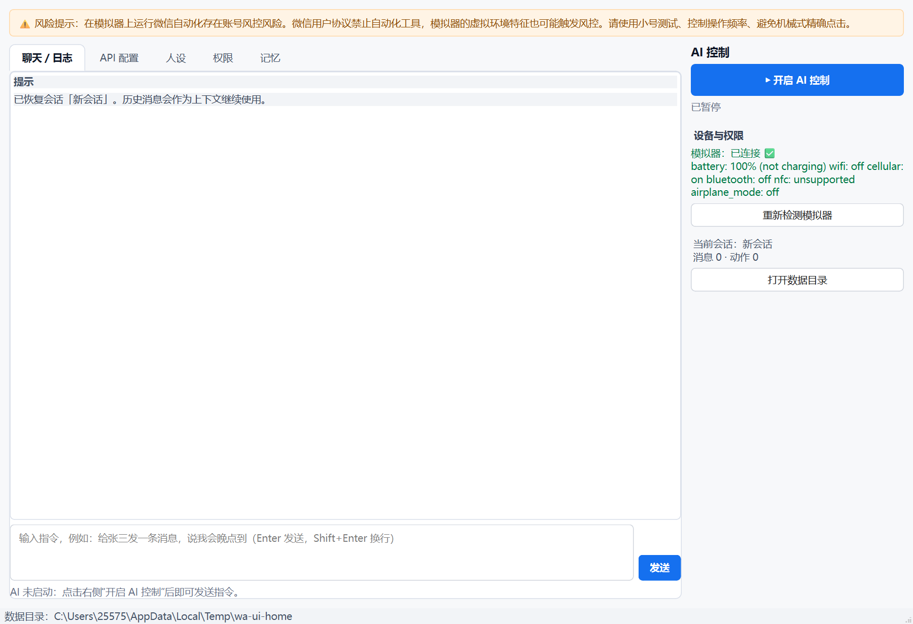
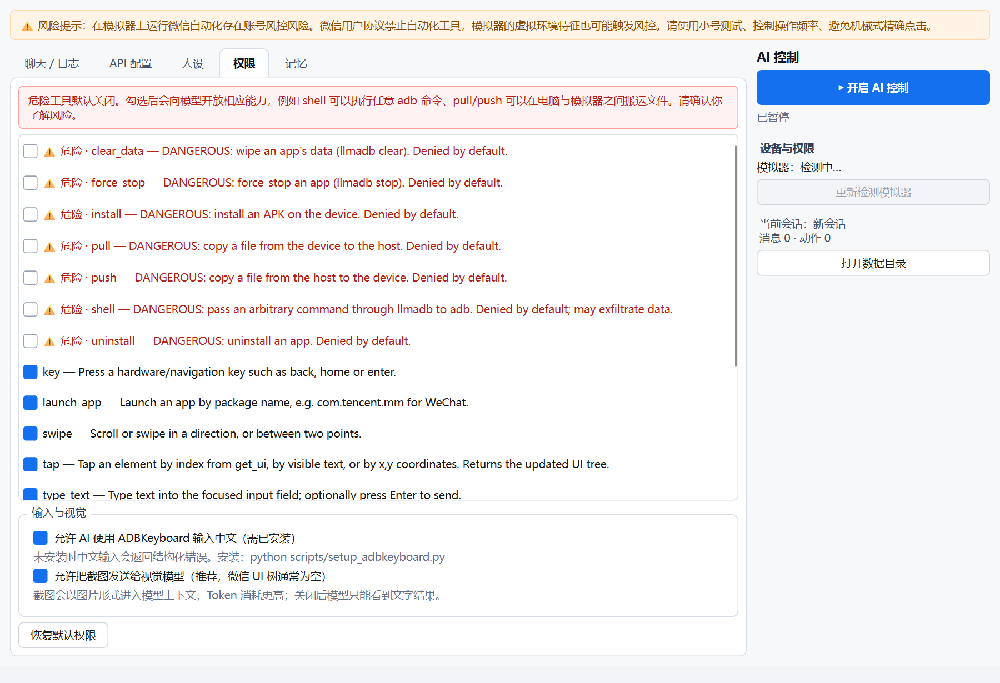
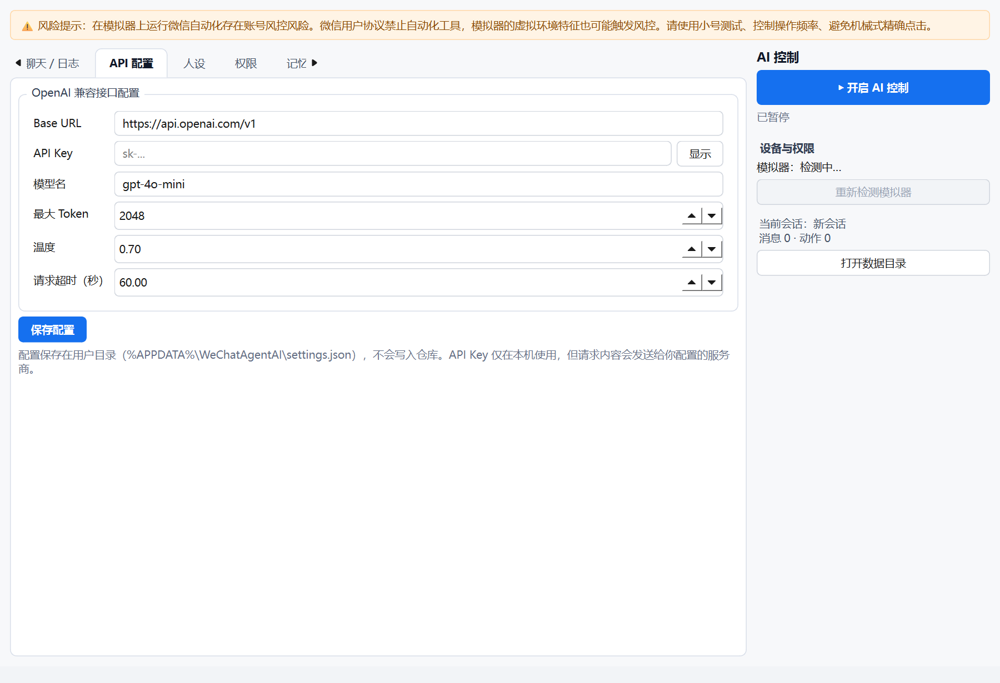
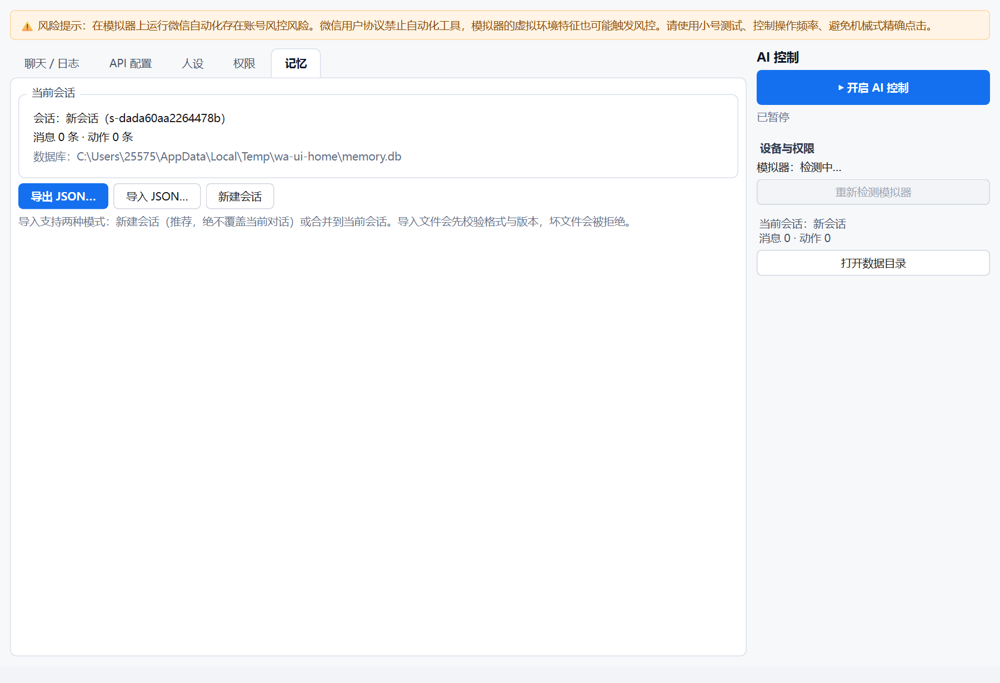
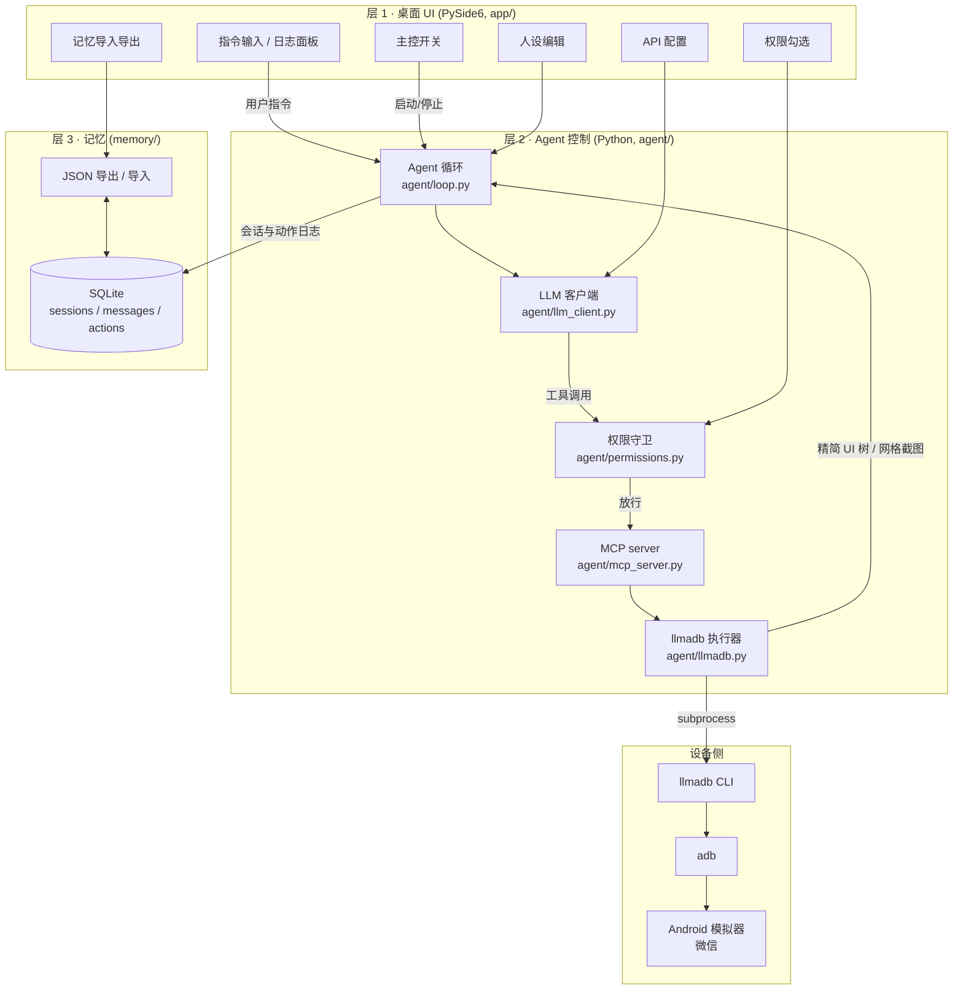

# WeChat Agent AI · 微信桌面 AI 助理

[](LICENSE)
[](https://www.python.org/)
[](https://pypi.org/project/llm-adb/)

让接入的 LLM 通过 [llm-adb](https://pypi.org/project/llm-adb/) 控制安卓模拟器里的微信，完成收发消息等聊天操作。
桌面端是 PySide6 单进程应用：配置 API、编辑人设、勾选权限、一键开关 AI 控制、查看与导入导出聊天记忆。

> A Windows desktop app that lets an LLM drive WeChat inside an Android emulator through
> `llmadb` (a token-efficient adb wrapper) and an MCP tool server. Single Python
> toolchain, MIT licensed, contributor-friendly.

---

## ⚠️ 风险提示（务必先读）

在模拟器上运行微信自动化存在**账号风控风险**：微信用户协议禁止自动化工具，模拟器的虚拟环境特征
也可能触发风控。请：

- **只用小号测试**，不要在主号上运行；
- 控制操作频率，避免机械式、精确到像素的重复点击；
- 随时准备手动接管，出现验证码/安全提示立即停止。

本项目仅用于学习与研究，使用者需自行承担账号风险。

---

## 当前进度

| 阶段 | 内容 | 状态 |
| --- | --- | --- |
| 1 | 环境校验与项目骨架 | ✅ 已完成（见下方环境校验结果） |
| 2 | MCP server、Agent 循环、权限守卫 | ✅ 已完成（52 个单元测试 + 3 个真机集成测试通过） |
| 3 | SQLite 记忆与导入导出 | ✅ 已完成（三张表 + JSON 双模式导入，16 个记忆层测试） |
| 4 | PySide6 桌面 UI | ✅ 已完成（5 个页签全部接入 Agent / 记忆，8 个 UI 测试） |
| 5 | 微信场景 prompt 与鲁棒性 | ✅ 已完成（微信指南、ADBKeyboard 中文输入、视觉截图闭环、失败熔断；已在「文件传输助手」完成真机中文发送） |
| 6 | 测试、文档与开源准备 | ✅ 已完成（93 个测试、CI、PyInstaller 打包、Issue/PR 模板、安全策略） |

---

## 界面预览

截图为本机真实渲染（含已连接的 BlueStacks 模拟器状态）。

| 主界面（聊天 / 日志） | 权限配置 |
| --- | --- |
|  |  |

| API 配置 | 记忆管理 |
| --- | --- |
|  |  |

---

## 技术选型：为什么是 PySide6（选项 B）

题目给出 Tauri 2 + Python sidecar 与 PySide6 两条路线。本项目选择 **PySide6 单进程**，理由：

| 维度 | PySide6（选用） | Tauri 2 + sidecar |
| --- | --- | --- |
| 工具链数量 | 1 套（Python） | 3 套（Rust + Node + Python） |
| 贡献者门槛 | 会 Python 即可改全栈 | 需同时懂 Rust / 前端 / Python |
| 本机可验证性 | `pip install -e .` 即可跑 | 需安装 Rust 工具链与 Node 构建链 |
| 打包体积 | 较大（约 80–150 MB） | 较小（约 10–30 MB） |
| UI 迭代效率 | 中（Qt Widgets） | 高（Web 前端） |

关键判断：**本项目 90% 的复杂度在 Agent 逻辑与设备交互，不在界面**。Tauri 省下的安装包体积
换来三套工具链的维护成本，对“开源、易贡献”这个首要目标不利。PySide6 让贡献者只装 Python
就能跑通全部流程，也便于 CI 无界面测试。

同时，UI 层被隔离在 `app/` 内，且只依赖 `agent/`、`memory/`、`config/` 的公开接口，
未来要换 Tauri/Web 前端，只需重写 `app/`，详见 [CONTRIBUTING.md](CONTRIBUTING.md)。

约束仍然满足：**MCP 层使用 Python MCP SDK**，**所有设备操作通过 `llmadb` CLI 子进程**，
不重复封装 ADB。

---

## 架构



**分层铁律**（review 时强制检查）：

- `agent/` 不导入 `app/`，也不直接操作 SQLite；
- `memory/` 不导入 `agent/`，从不调用 llmadb；
- `app/` 不含业务逻辑，只渲染事件、转发用户输入；
- 所有设备操作只经过 `agent/llmadb.py` → `llmadb` CLI。

细节见 [docs/architecture.md](docs/architecture.md)。

---

## 快速开始（Windows）

### 0. 前置条件

| 依赖 | 版本 / 说明 |
| --- | --- |
| Windows | 10 / 11 |
| Python | 3.11+（[python.org](https://www.python.org/downloads/)，安装时勾选 “Add to PATH”）。⚠ Windows 应用商店的 `python.exe` 只是占位符，装了也跑不了，务必用 python.org 版本；如果 PATH 里没有 python，直接使用项目内的 `.venv\Scripts\python.exe` |
| Android platform-tools | 提供 `adb`；可用 `winget install Google.PlatformTools` |
| llm-adb | PyPI 包 `llm-adb`，CLI 名 `llmadb` |
| 安卓模拟器 | 雷电 / MuMu / BlueStacks 等，**需在设置中开启 ADB 调试** |
| 微信 | 在模拟器内登录（建议小号） |

> 桌面端依赖 `PySide6-Essentials`（只含 Qt Widgets/Core/Gui），安装体积比完整 PySide6 小很多。

### 1. 安装

```powershell
git clone https://github.com/<you>/wechat-agent-ai.git
cd wechat-agent-ai

python -m venv .venv
.\.venv\Scripts\Activate.ps1

pip install -e ".[dev]"
```

### 2. 校验环境

```powershell
python scripts/check_env.py
```

预期输出（无模拟器时第二条为 WARN）：

```text
[ OK ] python    Python 3.12.14 (...)
[ OK ] adb       ...\platform-tools\adb.exe (Android Debug Bridge version 1.0.41)
[ OK ] llmadb    ...\.venv\Scripts\llmadb.exe (llmadb 0.1.2)
[WARN] device    no emulator connected
[WARN] api       ... (no API key)
[ OK ] data_dir  C:\Users\<you>\AppData\Roaming\WeChatAgentAI
```

### 3. 连接模拟器

先启动模拟器并开启 ADB，然后：

```powershell
adb connect 127.0.0.1:5555     # 端口按模拟器而定：雷电 5555、MuMu 7555、BlueStacks 5555
adb devices
llmadb status
```

拿到 `<serial>` 后可写入配置：`settings.json` 的 `runtime.device_serial`，
或设置环境变量 `LLMADB_SERIAL`。

### 4. 启动桌面端

```powershell
python -m app.main
```

或在安装后直接运行 `wechat-agent`。

---

## 使用流程

1. **API 配置**：填写 Base URL、API Key、模型名（可点“显示”核对 Key），保存后写入本机 `settings.json`。
2. **人设**：编辑多行人设并保存；保存后下一轮对话立即生效。
3. **权限**：按需勾选工具。危险工具（shell / install / uninstall / pull / push / clear_data / force_stop）
   默认关闭且标红，勾选时会二次确认。
4. **开启 AI 控制**：点击右侧主按钮。若未配置 API Key 会提示并跳转到配置页。
5. **下发指令**：在“聊天 / 日志”输入框输入自然语言，Enter 发送、Shift+Enter 换行。
   面板会依次显示你的指令、AI 文本回复、工具调用与精简结果；原始 UI 大块内容不会进入日志。
6. **停止**：点击“■ 停止 AI 控制”。当前步骤结束后不再发起新调用，并**终止正在运行的 llmadb 子进程**。
7. **记忆**：在“记忆”页导出当前会话 JSON，或导入历史（新建会话 / 合并到当前），
   导入时可选择同时应用文件里的人设与权限。

状态含义：`已暂停`、`AI 运行中 · 等待指令`、`AI 思考中…`、`正在执行设备操作…`、`出错了，请查看日志`。

---

## 配置说明

配置写在 **用户数据目录**，不进入仓库：

| 平台 | 路径 |
| --- | --- |
| Windows | `%APPDATA%\WeChatAgentAI\` |
| macOS | `~/Library/Application Support/WeChatAgentAI/` |
| Linux | `~/.local/share/WeChatAgentAI/` |

其中：

| 文件 | 内容 |
| --- | --- |
| `settings.json` | API（Base URL / Key / 模型 / max_tokens / temperature）与运行时参数 |
| `persona.md` | 当前人设（默认取 `config/default_persona.md`） |
| `permissions.json` | 工具白名单/黑名单（默认取 `config/permissions.default.json`） |
| `memory.db` | SQLite 会话、消息、动作日志 |

环境变量覆盖（便于测试与便携部署）：`WECHAT_AGENT_HOME`、`WECHAT_AGENT_CONFIG`。

---

## 权限模型（默认最小化）

| 工具 | 类别 | 默认 | 说明 |
| --- | --- | --- | --- |
| `get_ui` | 读 | ✅ | 精简 UI 树 |
| `screenshot` | 读 | ✅ | 带 100px 网格的缩放截图 |
| `device_status` / `current_app` | 读 | ✅ | 设备与前台应用信息 |
| `tap` / `type_text` / `swipe` / `key` | 交互 | ✅ | 点击 / 输入 / 滑动 / 按键 |
| `launch_app` | 交互 | ✅ | 启动 App |
| `shell` | 危险 | ❌ 拒绝 | 透传任意 adb 命令，可能泄露数据 |
| `install` / `uninstall` / `pull` / `push` | 危险 | ❌ 拒绝 | 安装卸载与文件传输 |

- `denied_tools` 永远优先于 `allowed_tools`；
- 未知工具名在加载配置时直接报错，避免拼写错误悄悄放大权限；
- 每次工具调用前都会检查，拒绝时向模型返回结构化错误（`permission_denied`），
  让模型换策略而不是崩溃。

详见 [docs/permissions.md](docs/permissions.md)。

---

## MCP 工具服务

`agent/mcp_server.py` 把 llmadb 能力暴露为 MCP 工具，stdio 传输：

```powershell
python -m agent.mcp_server
# 或在 MCP 客户端配置：command = "<venv>\\python.exe", args = ["-m", "agent.mcp_server"]
```

已注册工具：`get_ui`、`device_status`、`current_app`、`tap`、`type_text`、`screenshot`、
`launch_app`、`swipe`、`key`、`wait_for`，以及默认拒绝的危险工具
`shell`、`install`、`uninstall`、`pull`、`push`、`clear_data`、`force_stop`。
所有调用都先经过权限守卫；`screenshot` 直接返回 MCP 图片内容（llmadb 已缩放并叠加 100px 网格）。

---

## 记忆与导入导出

- 本地 SQLite：`%APPDATA%\WeChatAgentAI\memory.db`，三张表
  `sessions` / `messages` / `actions`（启用 WAL 与外键级联删除）。
- 导出为 JSON，包含 `persona`、`permissions`、`messages`、`actions`，原子写入避免半截文件。
- 导入两种模式：`new_session`（默认，恢复为新会话，绝不覆盖当前会话）与
  `merge_current`（追加到当前会话）。
- 导入前校验 `format`/`version`/角色/状态，坏文件直接拒绝并给出原因。

示例（节选）：

```json
{
  "format": "wechat-agent-memory",
  "version": 1,
  "persona": "你是一个微信助理…",
  "permissions": { "allowed_tools": ["get_ui", "tap"], "denied_tools": ["shell"] },
  "messages": [{ "role": "user", "content": "给张三发消息", "created_at": "…" }],
  "actions": [{ "tool_name": "get_ui", "arguments": {}, "status": "ok", "created_at": "…" }]
}
```

---

## 中文输入（ADBKeyboard）

Android 的 `input text` 无法输入中文，本项目通过开源输入法 **ADBKeyboard** 注入 Unicode：

```powershell
# 一次性安装（自动下载 APK、安装并启用 IME，可重复执行）
python scripts/setup_adbkeyboard.py

# 只检查状态
python scripts/setup_adbkeyboard.py --check
```

- 仅在输入**非 ASCII** 文本时自动切换到 ADBKeyboard，输入完成后**自动切回原输入法**；
- BlueStacks 等模拟器默认使用硬件键盘、隐藏软键盘，而 ADBKeyboard 只有视图显示时才注册广播接收器。
  程序会在开启 AI 时自动打开 `show_ime_with_hard_keyboard`，停止时恢复；
- 失败时返回结构化错误 `E_UNICODE_UNAVAILABLE` / `E_UNICODE_DISABLED`，让模型停下来报告，
  而不是把错误内容发出去；
- “权限”页签的「输入与视觉」可以关闭中文输入与截图发送。

## 微信界面的现实约束

实测微信（`com.tencent.mm`）大量界面对无障碍/UI 树**不可见**：`llmadb ui` 返回
`E_SECURE_OR_EMPTY`，但 `llmadb screen` 截图正常。因此本项目默认开启
**视觉闭环**：套接字内的截图（已缩放 + 100px 网格）会作为图片消息发给视觉模型，
配合 `config/wechat_prompt.md` 的坐标操作指南行动。旧截图会自动裁剪，只保留最近 2 张。

---

## 目录结构

```text
.
├── app/                 # 层 1：PySide6 桌面 UI（无业务逻辑）
│   ├── main.py          # 入口
│   ├── main_window.py   # 主窗口：面板 ↔ Agent ↔ 记忆的接线
│   ├── style.py         # 全局 QSS
│   ├── worker.py        # QThread：指令执行、设备探测
│   └── widgets/         # 聊天 / API / 人设 / 权限 / 记忆面板
├── agent/               # 层 2：Agent 控制
│   ├── loop.py          # 指令 → LLM → 工具 → llmadb → LLM
│   ├── llm_client.py    # OpenAI 兼容客户端
│   ├── llmadb.py        # llmadb 执行层（argv、超时、进程树终止）
│   ├── unicode_input.py # ADBKeyboard 中文输入驱动
│   ├── mcp_server.py    # MCP 工具服务
│   ├── permissions.py   # 权限守卫
│   ├── prompts.py       # 系统提示词（人设 + 权限 + 微信指南）
│   └── tools.py         # 工具目录（单一事实来源）
├── memory/              # 层 3：SQLite 与 JSON 导入导出
│   ├── db.py            # MemoryStore
│   ├── transfer.py      # export_session / import_session
│   └── schema.sql
├── config/              # 配置、人设、权限 schema、wechat_prompt.md 微信指南
├── docs/                # 架构、权限、风险文档
├── scripts/             # check_env / setup_adbkeyboard / smoke_device / build
├── tests/               # 无模拟器可跑的测试；integration 标记需真机
├── .github/             # CI 与 Issue / PR 模板
├── docs/                # 架构、权限、风险
├── CONTRIBUTING.md
├── SECURITY.md
├── pyproject.toml
└── README.md
```

---

## 本次环境校验结果（2026-11-19，本机）

| 项 | 结果 |
| --- | --- |
| Python | ✅ 3.12.14（项目 `.venv`；系统 PATH 上的 `python` 是 Microsoft Store 占位符，未使用） |
| adb | ✅ platform-tools 37.0.1（`%LOCALAPPDATA%\Android\platform-tools\adb.exe` 新装） |
| llmadb | ✅ llm-adb 0.1.2（`.venv\Scripts\llmadb.exe`） |
| 模拟器 | ✅ 已连接 `127.0.0.1:5555`（BlueStacks），`llmadb status` / `llmadb ui` 正常 |
| API Key | ⚠️ 未配置 |
| 数据目录 | ✅ `%APPDATA%\WeChatAgentAI` 可写 |

结论：工具链与模拟器全部就绪。`llmadb ui` 单屏输出约 15 行，符合预期的精简体积；
真机集成测试（设备状态、UI 树、Agent 循环端到端）全部通过。

---

## 开发与测试

```powershell
ruff check app agent memory config scripts tests     # 静态检查
pytest -q                                            # 单元 + UI 测试（无需模拟器）
```

真机集成测试默认跳过：

```powershell
$env:WECHAT_AGENT_DEVICE_TEST = "1"
pytest -m integration -q
python scripts/smoke_device.py --type                # 状态 / UI / 截图 / 中文输入+清空
```

打包（PyInstaller，输出 `release/WeChatAgentAI/`）：

```powershell
powershell -ExecutionPolicy Bypass -File scripts/build.ps1
```

打包版不内嵌 llmadb 与 adb：目标机器仍需安装 `llm-adb` 与 Android platform-tools，
并把 `llmadb` 放入 PATH（或在 `settings.json` 写 `runtime.llmadb_path`）。

---

## 常见问题

**Q：启动提示“API Key 为空”？**
在「API 配置」填写 Base URL / Key / 模型名并保存；Key 只存本机 `settings.json`。

**Q：设备显示未连接？**
确认模拟器已启动、开启 ADB 调试，执行 `adb connect 127.0.0.1:5555`（端口随模拟器而变），
再点“重新检测模拟器”。必要时在 `settings.json` 设置 `runtime.device_serial`。

**Q：`llmadb: not found`？**
`pip install llm-adb`，或把路径写入 `runtime.llmadb_path`。运行 `python scripts/check_env.py` 体检。

**Q：中文发不出去？**
先运行 `python scripts/setup_adbkeyboard.py`。若模拟器是 BlueStacks，程序会自动开启软键盘；
若仍失败，用 `python scripts/smoke_device.py --type` 定位。

**Q：模型看不到微信界面？**
这是正常的：微信屏蔽了无障碍树。确认「权限」页签里“允许把截图发送给视觉模型”已勾选，
并使用**支持图片输入**的模型。

**Q：出现“账号被限制与对方聊天”？**
微信账号状态问题，程序会停止并提示，请更换账号或联系对方后重试。

**Q：导出文件能跨电脑用吗？**
可以，JSON 含人设与权限；导入默认新建会话，不会覆盖当前对话。

---

## 路线图

1. **阶段 1** ✅：环境校验 + 骨架 + README。
2. **阶段 2** ✅：MCP server（17 个工具）、Agent 循环、权限守卫。
3. **阶段 3** ✅：SQLite 记忆层、导出/导入（新会话 / 合并两种模式）。
4. **阶段 4** ✅：完整桌面 UI（配置、人设、权限勾选、主控、日志、记忆管理）。
5. **阶段 5** ✅：`config/wechat_prompt.md`、ADBKeyboard 中文输入、视觉截图闭环、重试与降级策略。
6. **阶段 6** ✅：CI、打包脚本、Issue/PR 模板、安全策略、冒烟脚本。

后续可扩展方向（欢迎 PR）：更多 MCP 工具（如 `ocr` 独立工具）、多设备切换、
会话摘要压缩、插件式桌面前端（Tauri/Web）。

---

## 贡献

见 [CONTRIBUTING.md](CONTRIBUTING.md)。欢迎提交新 MCP 工具、新的人设模板、
对其他模拟器/操作系统的适配。

## License

[MIT](LICENSE)
