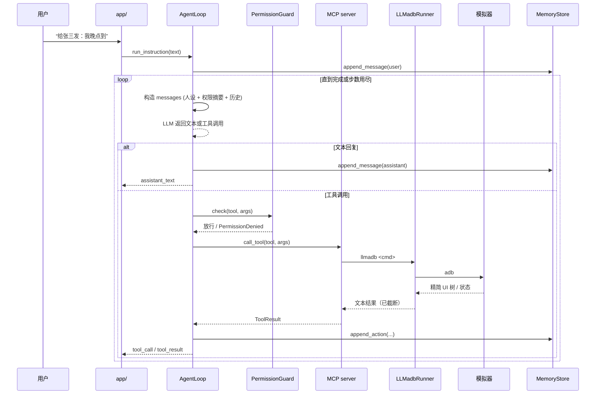

# 架构说明（Architecture）

## 1. 目标与约束

- **目标**：用户用自然语言下指令，LLM 通过 llmadb 操作模拟器中的微信完成收发消息。
- **硬约束**：
  - 设备操作只能走 `llmadb` CLI（PyPI `llm-adb`），不自己封装 adb；
  - 送给模型的内容必须是 llmadb 的精简输出（UI 索引树、带网格的缩放截图），
    不得把原始 uiautomator XML 或全分辨率截图塞进上下文；
  - 危险工具默认拒绝；
  - 每层有明确边界，UI 不含业务逻辑，Agent 不碰 SQLite，记忆层不调 llmadb。

## 2. 三层结构

```text
┌──────────────────────────── 层 1 · app/ (PySide6) ────────────────────────────┐
│ 主窗口 / 日志面板 / API 配置 / 人设 / 权限勾选 / 主控开关 / 记忆导入导出      │
└───────────────▲───────────────────────────────────────────────┬───────────────┘
                │ 事件 (AgentEvent)                              │ 用户输入
┌───────────────┴──────────────── 层 2 · agent/ ────────────────▼───────────────┐
│ AgentLoop ── LLMClient ── PermissionGuard ── MCP server ── LLMadbRunner        │
└───────────────▲───────────────────────────────────────────────┬───────────────┘
                │ 读写会话                                      │ subprocess
┌───────────────┴───────────── 层 3 · memory/ ────────────────┐  ▼                │
│ MemoryStore (SQLite) / export_session / import_session      │  llmadb → adb    │
└─────────────────────────────────────────────────────────────┘  → 模拟器微信     │
```

## 3. 一次指令的时序



## 4. 模块边界

| 模块 | 允许依赖 | 禁止 |
| --- | --- | --- |
| `config/` | 标准库 | 一切上层包 |
| `memory/` | `config`、标准库 | `agent`、`app`、llmadb |
| `agent/` | `config`、标准库、mcp、openai | `app`、直接 SQL、直接 adb |
| `app/` | `agent`、`memory`、`config` | 直接 subprocess、直接 SQL |

CI 与 review 据此检查导入（阶段 6 用 ruff 的 `flake8-tidy-imports` 或自定义测试强化）。

## 5. 关键设计决策

### 5.1 为什么通过 subprocess 调用 llmadb，而不是 import

- llmadb 是 CLI 优先设计的工具，输出即为“给模型看的文本”；
- 子进程边界让我们能超时、杀进程（主控关闭时立即停止）、注入 `LLMADB_ADB` / `LLMADB_SERIAL`；
- 版本升级无需改代码，PyPI 更新即生效；
- 失败可返回结构化错误（`E_NO_DEVICE` 等），交给模型决策。

### 5.2 工具目录是单一事实来源

`agent/tools.py` 的 `TOOL_CATALOG` 同时驱动：

1. MCP server 的工具 schema；
2. 权限守卫的工具名校验；
3. Agent 循环把调用翻译成 llmadb 参数。

新增工具只改这一处 + 一个翻译函数，不会出现“UI 允许但 MCP 没有”的不一致。

### 5.3 Token 预算

- UI 树：`llmadb ui` 的索引树（约 100–250 token/屏）；
- 截图：`llmadb screen` 的缩放网格图，仅在 UI 树无法识别自定义控件时降级使用；
- 工具结果统一截断（`--max-lines`），日志面板只显示摘要；
- 历史消息按“最近 N 轮 + 摘要”注入，避免上下文无限增长。

### 5.4 视觉闭环（微信 UI 树不可见的现实）

微信对 uiautomator 关闭了大部分界面（`E_SECURE_OR_EMPTY`），所以：

1. `screenshot` 的 PNG 被读入内存并 base64 编码；
2. AgentLoop 追加一条 `user` 消息，内容为 `[{type:text}, {type:image_url, data:...}]`；
3. 只保留最近 2 张截图（更早的替换为“已省略”占位），防止上下文爆炸；
4. 模型结合 100px 网格回到设备像素坐标，再调用 `tap x,y`。

图片消息不写入 SQLite（只在内存中），保证数据库体积与导出文件可控。

### 5.5 停止语义

主控关闭时：AgentLoop 置位 `STOPPED` → 当前步骤结束后不再发起新调用 →
取消尚未返回的 `llmadb` 子进程（终止进程树）。UI 立即显示“已暂停”。

## 6. 扩展点

| 想做的事 | 改哪里 |
| --- | --- |
| 新增 MCP 工具 | `agent/tools.py` 加 `ToolSpec` + `agent/llmadb.py` 加参数构造 |
| 换 LLM 供应商 | `agent/llm_client.py`（OpenAI 兼容即可零改动） |
| 换桌面框架 | 重写 `app/`，保留 `agent/` 的 `AgentEvent` 契约 |
| 换存储 | `memory/db.py` 实现同一 `MemoryStore` 接口 |
| 改权限策略 | `agent/permissions.py` + `config/permissions.default.json` |

## 7. 阶段映射

| 阶段 | 交付模块 |
| --- | --- |
| 1 | 目录骨架、`config/settings.py`、`scripts/check_env.py`、README |
| 2 | `agent/llmadb.py`、`agent/mcp_server.py`、`agent/loop.py`、`agent/permissions.py` |
| 3 | `memory/db.py`、`memory/transfer.py` |
| 4 | `app/main_window.py`、`app/widgets/*` |
| 5 | `config/wechat_prompt.md`、`agent/unicode_input.py`、视觉闭环、重试/熔断 |
| 6 | `tests/`、CI、`CONTRIBUTING.md`、打包脚本 |
